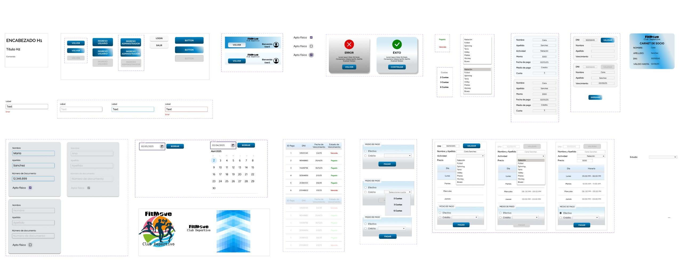

# ¡Hola! Soy Vanesa 👋

Desarrolladora **fullstack** en San Juan, Argentina. Trabajo con React, Next.js, Node.js y WordPress, y desde [VS Web Dev](https://vsweb.dev) hago sitios, tiendas online y aplicaciones a medida para pymes, emprendedores y agencias.

Hace más de 13 años doy clases online de matemática y programación, así que muchos de mis proyectos nacen ahí: herramientas que uso con mis propios alumnos.

---

### 🚀 Proyectos destacados

| Proyecto | Qué es | Stack |
|---|---|---|
| [**MathBoard**](https://github.com/Vane-SDev/MathBoard) | Pizarra colaborativa en tiempo real para clases de matemática, con laboratorios de geometría, cálculo y graficadores 3D. [Demo](https://mathboard.infinitamentemath.workers.dev/?sala=demo) | Next.js 16 · TypeScript · tldraw · Cloudflare Workers |
| [**Infinitamente Matemático**](https://github.com/Vane-SDev/Infinitamente-Website) | Sitio de mi marca de clases online. | Next.js · React |
| [**vsweb.dev**](https://vsweb.dev) | Sitio de VS Web Dev, con asistente de IA propio. | Astro · Python · FastAPI |

---

### 🎨 Diseño UI

Diseño en Figma las interfaces de mis proyectos antes de programarlas, con componentes, variantes, auto-layout y variables.

**FitMove · App de gestión para un club deportivo** — proyecto grupal de la tecnicatura, a cargo del diseño de la interfaz. [Ver en Figma](https://www.figma.com/design/GscWpGdKJxc971sj3LGUzW/Dispositivos-M%C3%B3viles)

Ver la librería de componentes

---

### 🛠️ Stack

  

   

  

---

### 📫 Contacto

- **Portfolio:** [vsweb.dev](https://vsweb.dev)
- **LinkedIn:** [vanesa-soria-webdev](https://www.linkedin.com/in/vanesa-soria-webdev/)
- **Email:** [vs.websdev@gmail.com](mailto:vs.websdev@gmail.com)
